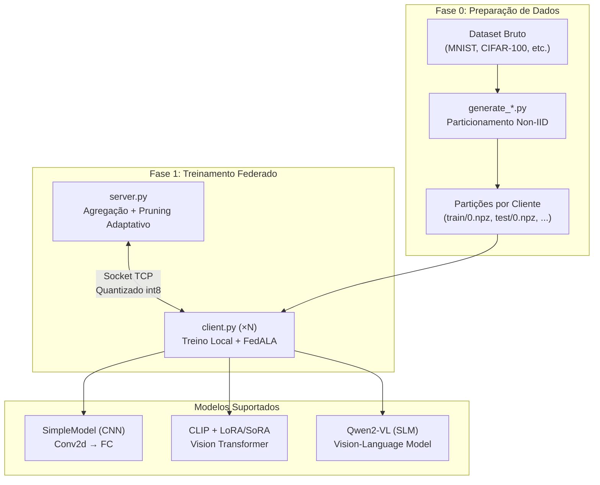
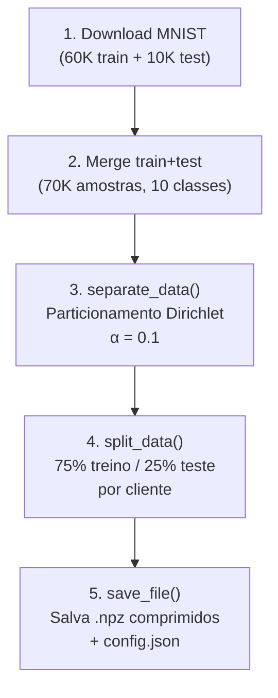
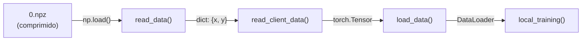

# 🔬 Análise do FL_ServerPuma — Simulador de Aprendizado Federado Adaptativo

> **Perspectiva:** Pesquisador de Engenharia da Computação — Aprendizado Federado & Otimização de LLMs/SLMs

---

## 1. Visão Geral da Arquitetura

O **FL_ServerPuma** é um simulador de pesquisa em Aprendizado Federado (FL) com foco em cenários de rede restrita. O projeto é derivado da biblioteca [PFLlib](https://github.com/TsingZ0/PFLlib) e foi estendido com contribuições originais significativas.



### Componentes Principais

| Componente | Arquivo | Função |
|---|---|---|
| **Geração de Dados** | `src/dataset/generate_*.py` | Particionamento Non-IID via Dirichlet |
| **Servidor FL** | `src/system/server.py` | Agregação FedAvg, Pruning Adaptativo, PaCA, Rank Adaptativo |
| **Cliente FL** | `src/system/client.py` | Treino local, FedALA, quantização int8 |
| **Modelo CNN** | `src/system/model.py` | SimpleModel (2×Conv2d + 2×FC) |
| **LoRA/SoRA** | `src/system/lora_clip/` | Adaptadores de baixo rank para CLIP |
| **Pruning** | `src/system/prunning.py` | Poda estrutural L2 (OPALA, NISP, SNIP) |
| **V2X** | `src/sumo_adapter/` | FL Veicular descentralizado com SUMO |

---

## 2. Pipeline de Geração de Datasets Non-IID

### 2.1 O Problema Fundamental: Por que Non-IID?

Em FL real, os dados dos clientes **nunca** são IID (Independent and Identically Distributed). Exemplos:
- Hospitais em regiões distintas veem patologias diferentes
- Celulares de usuários capturam fotos de contextos diferentes
- Veículos em cidades distintas encontram cenários viários diferentes

O FL_ServerPuma simula essa heterogeneidade via **particionamento Dirichlet** — o método mais amplamente aceito na literatura.

### 2.2 Invocação dos Scripts

```bash
# MNIST: Non-IID, desbalanceado, partição Dirichlet
uv run python src/dataset/generate_MNIST.py noniid - dir

# CIFAR-100: Non-IID, desbalanceado, partição Dirichlet
uv run python src/dataset/generate_Cifar100.py noniid - dir
```

**Decodificação dos argumentos CLI:**

| Argumento | Valor | Significado |
|---|---|---|
| `sys.argv[1]` | `noniid` | `niid=True` — ativa heterogeneidade |
| `sys.argv[2]` | `-` | `balance=False` — volumes desiguais por cliente |
| `sys.argv[3]` | `dir` | `partition="dir"` — algoritmo Dirichlet |

> [!IMPORTANT]
> O argumento `"-"` (traço) no segundo parâmetro é convertido para `balance=False` na lógica `True if sys.argv[2] == "balance" else False`. Isso garante distribuição **desbalanceada** — mais realista que distribuição uniforme.

---

## 3. Análise Profunda: `generate_MNIST.py`

**Arquivo:** [generate_MNIST.py](file:///home/jose/FL_ServerPuma/src/dataset/generate_MNIST.py)

### 3.1 Configuração Hardcoded

```python
random.seed(1)       # Reprodutibilidade
np.random.seed(1)    # Reprodutibilidade numpy
num_clients = 10     # 10 partições (clientes simulados)
dir_path = Path(__file__).parent / "MNIST"
```

> [!WARNING]
> `num_clients = 10` está **hardcoded** no script. Se você executar o Docker Compose com `--clients 15`, os clientes 10–14 não terão dados e falharão. Este é o aviso mais crítico do README.

### 3.2 Fluxo de Execução



### 3.3 Pré-processamento

```python
transform = transforms.Compose([
    transforms.ToTensor(),           # [0, 255] → [0.0, 1.0]
    transforms.Normalize([0.5], [0.5])  # [0, 1] → [-1, 1]
])
```

- **MNIST**: 1 canal (grayscale), 28×28 pixels
- Normalização com média=0.5, std=0.5 → range final `[-1, 1]`
- Total: **70.000 amostras** (train + test mesclados)

### 3.4 Parâmetro Chave: `class_per_client=2`

```python
X, y, statistic = separate_data(
    (dataset_image, dataset_label), num_clients, num_classes,
    niid, balance, partition, class_per_client=2  # ← CHAVE
)
```

Este parâmetro **não é usado** quando `partition="dir"` (Dirichlet). Ele só é relevante para `partition="pat"` (pathological) e `partition="exdir"`. Na prática, com Dirichlet e α=0.1, cada cliente naturalmente recebe 2-4 classes dominantes.

---

## 4. Análise Profunda: `generate_Cifar100.py`

**Arquivo:** [generate_Cifar100.py](file:///home/jose/FL_ServerPuma/src/dataset/generate_Cifar100.py)

### 4.1 Diferenças Estruturais vs. MNIST

| Aspecto | MNIST | CIFAR-100 |
|---|---|---|
| `num_clients` | **10** | **5** |
| Canais | 1 (grayscale) | 3 (RGB) |
| Resolução | 28×28 | 32×32 |
| Classes | 10 | **100** |
| Amostras totais | 70.000 | **60.000** |
| Normalização | `([0.5], [0.5])` | `((0.5,0.5,0.5), (0.5,0.5,0.5))` |
| `class_per_client` | 2 | **10** |
| Amostras/classe | ~7.000 | **~600** |

> [!CAUTION]
> CIFAR-100 com apenas **5 clientes** e **100 classes** cria uma situação onde cada cliente recebe em média 600×100/5 = 12.000 amostras, mas distribuídas de forma muito desequilibrada pelo Dirichlet (α=0.1). Alguns clientes podem ficar com 0 amostras de certas classes.

### 4.2 Impacto do `num_clients=5` com 100 Classes

Com α=0.1 e 5 clientes para 100 classes, o Dirichlet gera uma distribuição **extremamente heterogênea**:
- A maioria das 100 classes concentra quase todas as amostras em 1-2 clientes
- O `least_samples` garante um mínimo de `min(10/0.25, 60000/5/2) = min(40, 6000) = 40` amostras por cliente

---

## 5. O Motor Matemático: `separate_data()` com Partição Dirichlet

**Arquivo:** [dataset_utils.py](file:///home/jose/FL_ServerPuma/src/dataset/utils/dataset_utils.py) — linhas 99–123

Este é o **coração algorítmico** de toda a geração Non-IID. Vou detalhar cada linha:

### 5.1 Hiperparâmetros Globais

```python
batch_size = 10       # Batch mínimo para teste
train_ratio = 0.75    # 75% treino, 25% teste
alpha = 0.1           # Concentração Dirichlet ← CONTROLE DE HETEROGENEIDADE
```

### 5.2 O Algoritmo Dirichlet — Linha a Linha

```python
elif partition == "dir":
    min_size = 0
    K = num_classes       # 10 para MNIST, 100 para CIFAR-100
    N = len(dataset_label) # Total de amostras

    try_cnt = 1
    while min_size < least_samples:  # Loop de retry
        idx_batch = [[] for _ in range(num_clients)]

        for k in range(K):  # Para CADA classe k
            # 1. Encontra todos os índices da classe k
            idx_k = np.where(dataset_label == k)[0]
            np.random.shuffle(idx_k)

            # 2. Amostra proporções de uma Dirichlet(α, α, ..., α)
            proportions = np.random.dirichlet(np.repeat(alpha, num_clients))

            # 3. Balanceamento: zera proporção de clientes "cheios"
            proportions = np.array([
                p * (len(idx_j) < N/num_clients)
                for p, idx_j in zip(proportions, idx_batch)
            ])

            # 4. Re-normaliza para somar 1
            proportions = proportions / proportions.sum()

            # 5. Converte proporções em índices de corte
            proportions = (np.cumsum(proportions) * len(idx_k)).astype(int)[:-1]

            # 6. Divide os índices da classe k entre os clientes
            idx_batch = [
                idx_j + idx.tolist()
                for idx_j, idx in zip(idx_batch, np.split(idx_k, proportions))
            ]

            # 7. Verifica se o menor cliente tem amostras suficientes
            min_size = min([len(idx_j) for idx_j in idx_batch])

        try_cnt += 1  # Se min_size < least_samples, tenta de novo
```

### 5.3 Intuição Matemática da Distribuição Dirichlet

A distribuição **Dir(α₁, α₂, ..., αₙ)** gera um vetor de probabilidades que soma 1. O parâmetro α controla a **concentração**:

```
α = 0.1  →  Altamente heterogêneo (Non-IID forte)
             Uma proporção domina (~0.9), as outras → 0
             Cada classe vai quase inteira para 1 cliente

α = 1.0  →  Uniforme (medianamente IID)
             Proporções distribuídas igualmente

α = 100  →  Quase IID (todas as proporções ≈ 1/N)
             Cada cliente recebe ≈ mesmo número de cada classe
```

### 5.4 Visualização Conceitual (α = 0.1, MNIST, 10 clientes)

```
         Classe 0  Classe 1  Classe 2  ... Classe 9
Client 0  ████████  ░░░░░░░░  ░░░░░░░░      ░░░░░░░░
Client 1  ░░░░░░░░  ░░░░░░░░  ████████      ░░░░░░░░
Client 2  ░░░░░░░░  ████████  ░░░░░░░░      ░░░░░░░░
Client 3  ░░░░░░░░  ░░░░░░░░  ░░░░░░░░      ████████
...
(████ = concentração alta, ░░░░ = quase zero)
```

### 5.5 Mecanismo de Segurança: `least_samples`

```python
least_samples = int(min(
    batch_size / (1 - train_ratio),   # = 10/0.25 = 40
    len(dataset_label) / num_clients / 2
))
```

| Dataset | Cálculo | `least_samples` |
|---|---|---|
| MNIST (10 clients) | min(40, 70000/10/2) = min(40, 3500) | **40** |
| CIFAR-100 (5 clients) | min(40, 60000/5/2) = min(40, 6000) | **40** |

Se algum cliente receber menos de 40 amostras, o loop **descarta tudo e reamostra** a Dirichlet.

---

## 6. Pós-Particionamento: `split_data()` e `save_file()`

### 6.1 Split Treino/Teste (75/25)

```python
def split_data(X, y):
    for i in range(len(y)):
        X_train, X_test, y_train, y_test = train_test_split(
            X[i], y[i], train_size=0.75, shuffle=True
        )
```

> [!NOTE]
> O split é feito **por cliente**, não globalmente. Isso significa que cada cliente tem seu próprio conjunto de teste local, que reflete sua distribuição Non-IID particular. É uma decisão de design importante: a avaliação local mede o desempenho do modelo na distribuição local (personalização), não na distribuição global.

### 6.2 Persistência em Disco

```
src/dataset/MNIST/
├── config.json          ← Metadados (alpha, num_clients, etc.)
├── rawdata/             ← Download original do torchvision
├── train/
│   ├── 0.npz           ← Treino do Cliente 0 (x: imagens, y: labels)
│   ├── 1.npz           ← Treino do Cliente 1
│   └── ...
└── test/
    ├── 0.npz           ← Teste do Cliente 0
    ├── 1.npz
    └── ...
```

O `config.json` implementa **cache inteligente** — se os parâmetros coincidem com uma execução anterior, o script retorna imediatamente sem regenerar.

---

## 7. Como os Dados Chegam ao Cliente FL

O pipeline completo de dados, do disco até o treino:



**Arquivo:** [data_utils.py](file:///home/jose/FL_ServerPuma/src/utils/data_utils.py)

```python
def read_data(dataset, idx, is_train=True):
    train_data_dir = os.path.join('..', 'dataset', dataset, 'train/')
    train_file = train_data_dir + str(idx) + '.npz'
    with open(train_file, 'rb') as f:
        train_data = np.load(f, allow_pickle=True)['data'].tolist()
    return train_data  # dict com chaves 'x' e 'y'
```

> [!IMPORTANT]
> O caminho relativo `../dataset/` assume que o script é executado de dentro de `src/system/`. Isso é garantido pelo `run.sh` e pelo Docker Compose, mas quebraria se executado de outro diretório.

---

## 8. Relação Dataset → Modelo → Pruning

A escolha do dataset impacta diretamente a arquitetura e o pruning:

### 8.1 SimpleModel (CNN) — Dimensões por Dataset

```python
# server.py — pattern matching
match args.dataset:
    case 'MNIST':
        SimpleModel(in_features=1, num_classes=10, dim=1024)
        # Input: (1, 1, 28, 28)
    case 'Cifar10':
        SimpleModel(in_features=3, num_classes=10, dim=1600)
        # Input: (1, 3, 32, 32)
    case 'Cifar100':
        SimpleModel(in_features=3, num_classes=100, dim=1600)
        # Input: (1, 3, 32, 32)
```

O parâmetro `dim` é o tamanho do tensor após o flatten:
- **MNIST**: 1×28×28 → Conv(1→32, k=5) → Pool → Conv(32→64, k=5) → Pool → Flatten = 64×4×4 = **1024**
- **CIFAR**: 3×32×32 → Conv(3→32, k=5) → Pool → Conv(32→64, k=5) → Pool → Flatten = 64×5×5 = **1600**

### 8.2 Pruning Estrutural Adaptativo

No `prunning.py`, o dataset afeta o fator de replicação na transição Conv→Linear:

```python
if data == 'Cifar100' or data == 'Cifar10':
    indices_not_remove_weight = indices_not_remove_weight.repeat(25)  # 5×5 spatial
if data == 'MNIST':
    indices_not_remove_weight = indices_not_remove_weight.repeat(16)  # 4×4 spatial
```

---

## 9. Contribuições Originais do Projeto (além do PFLlib)

| Contribuição | Descrição |
|---|---|
| **Pruning Adaptativo (OPALA)** | Taxa de poda calculada dinamicamente por α (parâmetros) e β (FLOPs) por camada |
| **PaCA Adaptativo** | Ajuste dinâmico do número de encoder layers treinadas, com cooldown e reversão |
| **Rank Adaptativo (SoRA)** | Ajuste do rank LoRA/SoRA per-client baseado em latência + acurácia |
| **Quantização int8** | Compressão simétrica dos pesos para transmissão |
| **V2X Descentralizado** | FL veicular com SUMO, D-PSGD, ETC-based polling |
| **Infraestrutura `uv`** | Ambiente hermético e reprodutível sem Conda |

---

## 10. Observações Críticas e Pontos de Atenção

### 10.1 Duplicação de `dataset_utils.py`

Existem **duas versões** do arquivo:
- `src/dataset/dataset_utils.py` (273 linhas) — versão antiga com `os.path`
- `src/dataset/utils/dataset_utils.py` (275 linhas) — versão modernizada com `pathlib.Path`

O `generate_MNIST.py` importa de `dataset.utils.dataset_utils` (a versão nova). A versão antiga parece ser um artefato não utilizado.

### 10.2 Seed Fixo

```python
random.seed(1)
np.random.seed(1)
```

Bom para reprodutibilidade, mas significa que **todas as execuções geram a mesma partição**. Para estudos de ablation com diferentes partições, seria necessário parametrizar a seed.

### 10.3 Alpha (α) Hardcoded

O valor `alpha = 0.1` está hardcoded em `dataset_utils.py` e **não pode ser alterado pela CLI**. Para variar o grau de heterogeneidade, é necessário editar o código-fonte. Em projetos de pesquisa maduros, isso deveria ser um argumento de linha de comando.

### 10.4 Compatibilidade `num_clients`

O `num_clients` está hardcoded em cada `generate_*.py` e deve ser ≥ ao número de clientes no Docker Compose / tmux. Não há validação automática entre os dois — é responsabilidade do pesquisador.

---

## 11. Resumo Executivo

O FL_ServerPuma implementa um **pipeline completo de FL** que vai da geração sintética de dados Non-IID até a agregação com pruning adaptativo. Os scripts `generate_MNIST.py` e `generate_Cifar100.py` usam a **distribuição Dirichlet com α=0.1** para simular a heterogeneidade de dados encontrada em cenários reais de FL.

A escolha de α=0.1 é deliberadamente agressiva — cria partições onde cada cliente é dominado por poucas classes, forçando o sistema FL a lidar com divergência de gradientes e drift de modelo. Isso testa os mecanismos de personalização (FedALA) e compressão (pruning + quantização) sob condições adversas.

O projeto se destaca por combinar **4 dimensões de adaptação** (pruning estrutural, PaCA, rank LoRA/SoRA, quantização) em um único framework, algo raro na literatura de FL.
