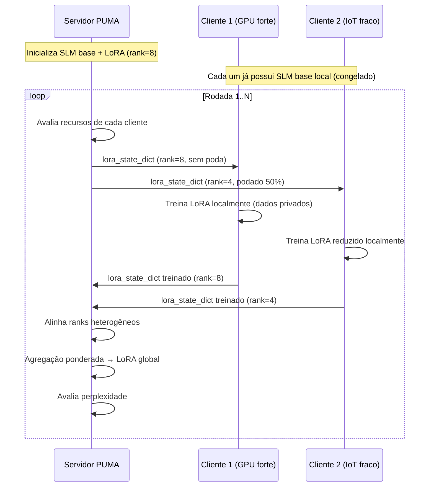

# Treinamento Federado de SLM com PEFT/LoRA no PUMA

## Contexto

O FL_ServerPuma atualmente treina um `SimpleModel` (CNN 2-conv + 2-fc) em datasets de imagem (CIFAR-10/100, MNIST). O objetivo é estendê-lo para suportar **fine-tuning federado de Small Language Models** (ex: `TinyLlama-1.1B`, `Phi-2`, `Qwen2-0.5B`) usando **PEFT/LoRA**, onde:

1. O **modelo base da SLM fica congelado** em todos os nós (nunca transmitido).
2. Apenas os **adaptadores LoRA** (< 1-5% dos parâmetros) são treinados localmente e sincronizados pelo servidor.
3. A **poda adaptativa do OPALA** atua sobre as matrizes LoRA, reduzindo ainda mais o volume de comunicação para clientes com recursos limitados.

## Decisões de Design

> [!IMPORTANT]
> **Modelo base escolhido para validação**: `TinyLlama/TinyLlama-1.1B-Chat-v1.0` — é pequeno o suficiente para rodar em GPUs consumer (8GB VRAM) e já possui uma boa base de linguagem. Podemos trocar por `Qwen/Qwen2-0.5B` se houver restrição de memória ainda maior.

> [!IMPORTANT]
> **Dataset para validação**: Usaremos o `Alpaca-cleaned` (52k instruções) particionado de forma Non-IID entre os clientes simulados, simulando um cenário onde cada "hospital" ou "organização" possui seus próprios dados textuais.

> [!WARNING]
> **Versão do PyTorch**: O projeto está travado em `torch==2.0.1`. O PEFT moderno requer `torch>=2.0`, então é compatível. Porém, se surgir incompatibilidade com `transformers` mais recente, faremos pin nas versões.

## Open Questions

> [!IMPORTANT]
> 1. **Qual SLM você prefere usar?** Opções viáveis:
>    - `TinyLlama/TinyLlama-1.1B-Chat-v1.0` (~1.1B params, ~4.4GB em fp32, ~2.2GB em fp16)
>    - `Qwen/Qwen2-0.5B` (~0.5B params, mais leve)
>    - `microsoft/phi-2` (~2.7B params, precisa de mais VRAM)
>    - Outro modelo de sua preferência?
>
> 2. **Qual dataset de texto deseja usar para o fine-tuning federado?** Opções:
>    - `yahma/alpaca-cleaned` (instrução genérica, 52k exemplos)
>    - Dataset médico/domínio específico?
>    - Dataset customizado que você já possui?
>
> 3. **Quantos clientes simulados e rodadas para o experimento de validação?** Sugiro começar com 3 clientes e 5 rodadas.
>
> 4. **A simulação deve rodar localmente (Tmux/manual) ou via Docker?** Sugiro local primeiro para iteração rápida.

---

## Proposed Changes

A implementação se divide em 6 componentes. Os arquivos existentes serão modificados com cuidado para manter retrocompatibilidade com o fluxo CNN atual.

---

### Componente 1: Dependências e Configuração

#### [MODIFY] [pyproject.toml](file:///home/jose/veiga/FL_ServerPuma/pyproject.toml)

Adicionar as dependências PEFT e datasets:

```diff
 # Advanced ML
 "cvxpy",
 "higher",
 "diffusers",
 "accelerate",
 "transformers",
+# SLM / PEFT
+"peft>=0.7.0",
+"datasets",
+"sentencepiece",
+"protobuf",
```

---

### Componente 2: Modelo SLM com LoRA

#### [NEW] [slm_model.py](file:///home/jose/veiga/FL_ServerPuma/src/system/slm_model.py)

Módulo responsável por carregar a SLM base e configurar os adaptadores LoRA via PEFT.

**Funcionalidades:**
- `load_slm_with_lora(model_name, lora_config)` → Carrega o modelo base congelado + adaptadores LoRA
- `get_lora_state_dict(model)` → Extrai **apenas** os parâmetros LoRA (para envio pela rede)
- `set_lora_state_dict(model, state_dict)` → Carrega parâmetros LoRA recebidos do servidor
- `get_lora_param_count(model)` → Conta parâmetros treináveis vs total
- Configuração LoRA padrão: `r=8`, `lora_alpha=16`, `target_modules=["q_proj", "v_proj"]`, `lora_dropout=0.05`

```python
# Esqueleto
from peft import get_peft_model, LoraConfig, TaskType
from transformers import AutoModelForCausalLM, AutoTokenizer

def load_slm_with_lora(model_name, lora_r=8, lora_alpha=16, target_modules=None, device="cuda"):
    tokenizer = AutoTokenizer.from_pretrained(model_name)
    base_model = AutoModelForCausalLM.from_pretrained(model_name, torch_dtype=torch.float16)
    
    lora_config = LoraConfig(
        task_type=TaskType.CAUSAL_LM,
        r=lora_r,
        lora_alpha=lora_alpha,
        target_modules=target_modules or ["q_proj", "v_proj"],
        lora_dropout=0.05,
    )
    
    model = get_peft_model(base_model, lora_config)
    model.print_trainable_parameters()  # Ex: "trainable params: 4,194,304 || all params: 1,100,000,000 || trainable%: 0.38%"
    return model, tokenizer
```

---

### Componente 3: Poda Adaptativa de LoRA (OPALA-LoRA)

#### [NEW] [prunning_lora.py](file:///home/jose/veiga/FL_ServerPuma/src/system/prunning_lora.py)

Módulo que aplica a filosofia OPALA especificamente nos adaptadores LoRA.

**Estratégia de poda para LoRA:**
- Em vez de podar neurônios (como na CNN), podaremos **colunas/linhas das matrizes LoRA_A e LoRA_B** com base na magnitude
- Equivale a **reduzir o rank efetivo** do LoRA para clientes com menos recursos
- O servidor mantém o rank completo e alinha os adaptadores recebidos de diferentes ranks

```python
def prune_lora_state_dict(lora_state_dict, pruning_rate, method="magnitude"):
    """
    Poda adaptativa dos parâmetros LoRA.
    
    Para cada par (lora_A, lora_B):
    - Calcula importância de cada dimensão de rank
    - Remove as dimensões menos importantes (zerando ou truncando)
    - Retorna o state_dict podado + máscara de reconstrução
    """
    ...

def align_lora_to_global(local_lora_dict, global_lora_dict, masks):
    """
    Alinha um adaptador LoRA podado (rank menor) de volta
    para a estrutura global (rank completo) usando máscaras.
    """
    ...
```

---

### Componente 4: Dataset de Texto Federado

#### [NEW] [generate_Alpaca.py](file:///home/jose/veiga/FL_ServerPuma/src/dataset/generate_Alpaca.py)

Gerador de dataset de instrução-tuning particionado para FL, seguindo o padrão existente dos geradores (`generate_Cifar100.py`, `generate_AGNews.py`).

**Funcionalidades:**
- Baixa o dataset `yahma/alpaca-cleaned` via HuggingFace `datasets`
- Particiona Non-IID entre N clientes (por comprimento de instrução ou por categorias temáticas)
- Salva em formato `.npz` compatível com `data_utils.read_client_data()`
- Cada amostra: `{"x": tokens_ids_padded, "y": labels_ids_padded}`

#### [MODIFY] [data_utils.py](file:///home/jose/veiga/FL_ServerPuma/src/system/data_utils.py)

Adicionar handler `read_client_data_slm()` para carregar dados tokenizados para SLM:

```python
def read_client_data_slm(dataset, idx, tokenizer, max_length=512, is_train=True):
    """Carrega dados de texto tokenizados para fine-tuning de SLM."""
    data = read_data(dataset, idx, is_train)
    # Retorna dict com input_ids, attention_mask, labels
    ...
```

---

### Componente 5: Servidor FL para SLM

#### [NEW] [server_slm.py](file:///home/jose/veiga/FL_ServerPuma/src/system/server_slm.py)

Servidor federado especializado para SLM. Herda/reutiliza a lógica de `FederatedLearningServer` mas opera sobre adaptadores LoRA.

**Diferenças do server.py original:**
- Inicializa o modelo base + LoRA em vez do `SimpleModel`
- `handle_client()` envia/recebe **apenas** o `lora_state_dict` (não o modelo inteiro)
- `aggregate_models()` agrega os adaptadores LoRA com pesos proporcionais ao dataset
- A poda OPALA atua sobre o `lora_state_dict` antes do envio
- A avaliação usa geração de texto (perplexidade) em vez de acurácia de classificação

**Argparse adicional:**
```
--mode slm                    # Ativa modo SLM (vs CNN padrão)
--slm-model TinyLlama/TinyLlama-1.1B-Chat-v1.0
--lora-r 8
--lora-alpha 16
--lora-target-modules q_proj,v_proj
--max-seq-length 512
```

#### [NEW] [client_slm.py](file:///home/jose/veiga/FL_ServerPuma/src/system/client_slm.py)

Cliente federado especializado para SLM.

**Diferenças do client.py original:**
- Carrega o modelo base localmente (congelado, nunca enviado)
- Recebe `lora_state_dict` do servidor → aplica no modelo → treina localmente
- Envia de volta apenas o `lora_state_dict` treinado
- Usa `SFTTrainer` ou loop manual com `CrossEntropyLoss` para causal LM

---

### Componente 6: Orquestração

#### [MODIFY] [generate_compose.py](file:///home/jose/veiga/FL_ServerPuma/generate_compose.py)

Adicionar opção `--mode slm` que gera compose com `server_slm.py` e `client_slm.py`.

#### [NEW] [run_slm.sh](file:///home/jose/veiga/FL_ServerPuma/src/system/run_slm.sh)

Script tmux para execução local do cenário SLM (similar ao `run.sh` existente).

---

## Arquitetura do Fluxo de Dados



---

## Estrutura de Arquivos Final

```
src/
├── system/
│   ├── server.py              # (existente, sem mudanças)
│   ├── client.py              # (existente, sem mudanças)
│   ├── server_slm.py          # [NEW] Servidor FL para SLM
│   ├── client_slm.py          # [NEW] Cliente FL para SLM
│   ├── slm_model.py           # [NEW] Carregamento SLM + LoRA
│   ├── prunning_lora.py       # [NEW] Poda OPALA para LoRA
│   ├── run_slm.sh             # [NEW] Script de execução
│   ├── model.py               # (existente, sem mudanças)
│   ├── prunning.py            # (existente, sem mudanças)
│   └── ...
├── dataset/
│   ├── generate_Alpaca.py     # [NEW] Gerador de dataset Alpaca
│   └── ...
└── utils/
    ├── fl_math.py             # (existente, sem mudanças)
    └── ...
```

---

## Verification Plan

### Automated Tests

1. **Smoke test do modelo LoRA:**
   ```bash
   cd src/system && uv run python -c "from slm_model import load_slm_with_lora; m, t = load_slm_with_lora('TinyLlama/TinyLlama-1.1B-Chat-v1.0'); print('OK')"
   ```

2. **Teste de poda LoRA:**
   ```bash
   cd src/system && uv run python -c "from prunning_lora import prune_lora_state_dict; ..."
   ```

3. **Teste end-to-end com 2 clientes, 2 rodadas:**
   ```bash
   # Terminal 1
   cd src/system && uv run python server_slm.py --clients-per-round 2 --rounds 2 --slm-model TinyLlama/TinyLlama-1.1B-Chat-v1.0
   
   # Terminal 2
   cd src/system && uv run python client_slm.py --client-idx 0 --rounds 2
   
   # Terminal 3
   cd src/system && uv run python client_slm.py --client-idx 1 --rounds 2
   ```

4. **Verificar que os resultados .h5 são gerados com métricas de perplexidade.**

### Manual Verification

- Verificar que o tamanho transmitido (LoRA state_dict) é << tamanho do modelo completo
- Verificar que a poda reduz o tamanho do LoRA proporcionalmente ao rate
- Verificar convergência da perplexidade ao longo das rodadas
- Comparar com fine-tuning centralizado (baseline)
